# 薪动 XinDong

> 实时计薪 · 带薪摸鱼回血 · 义务加班扎心账本 · 误触下班撤回 · 老板夺命 Call · 防抹零下班拦截 · 老板键暗语伪装

纯 **C# WPF (.NET 8)** 实现，**零第三方 NuGet 依赖**，绿色便携：整个文件夹拷到任何 Windows 10/11 x64 电脑，双击 `XinDong.exe` 即用，配置与账本随文件夹一起迁移。


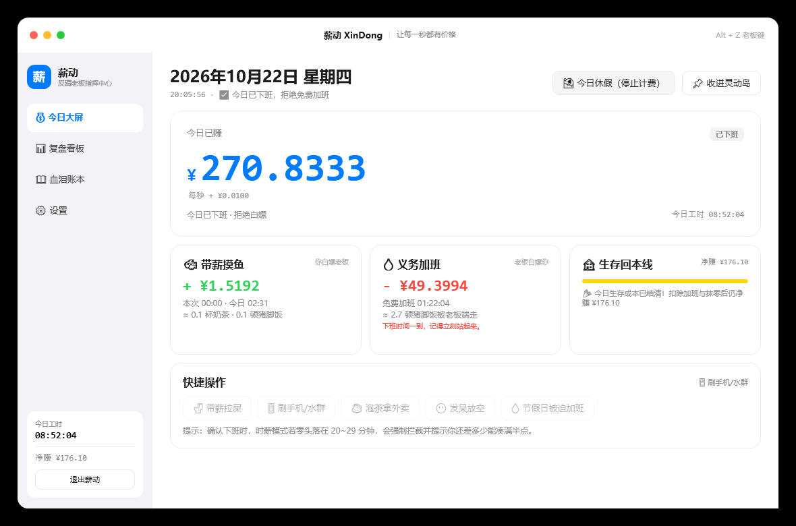

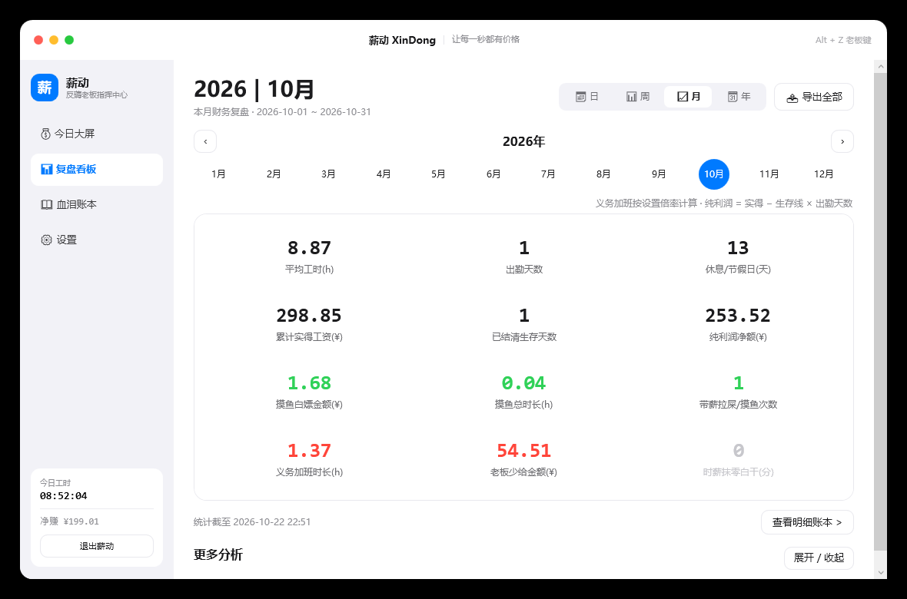

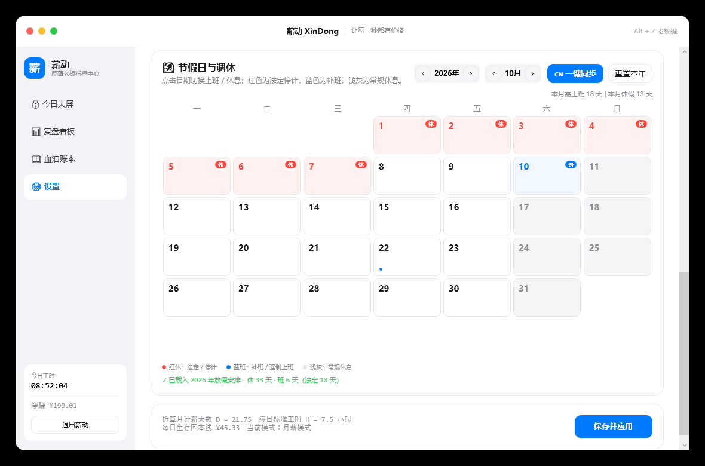


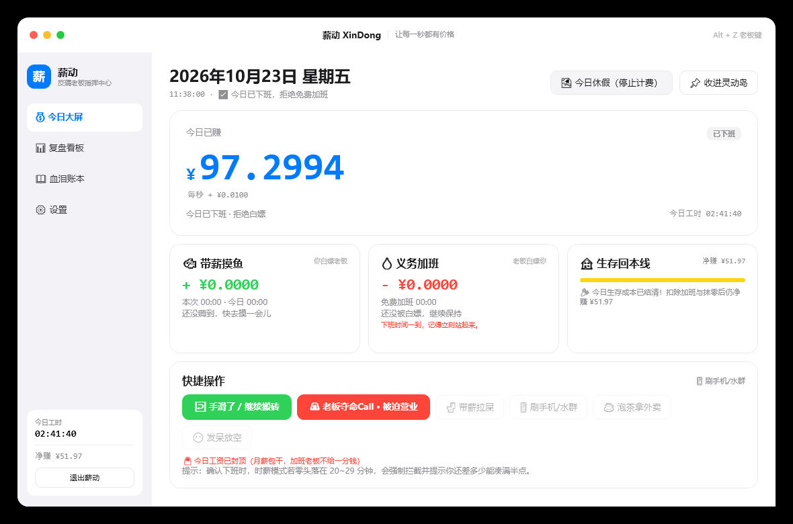

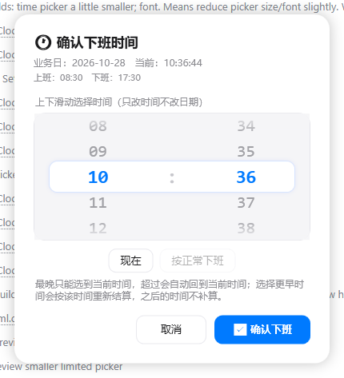

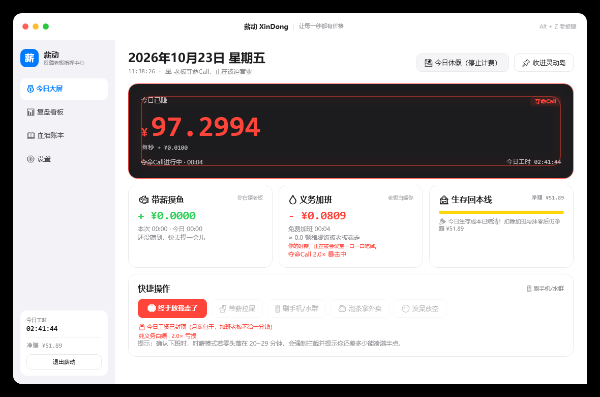


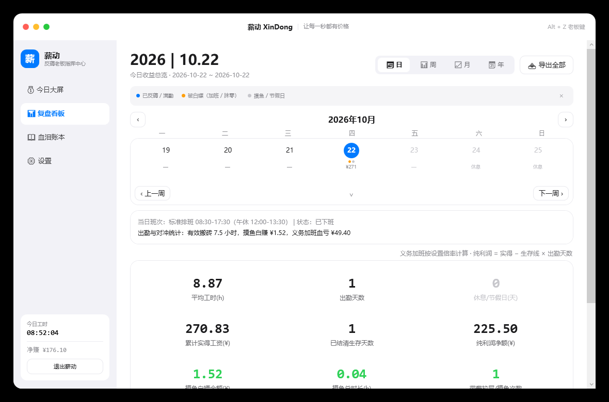

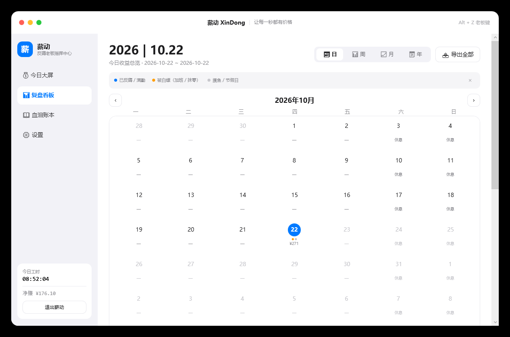

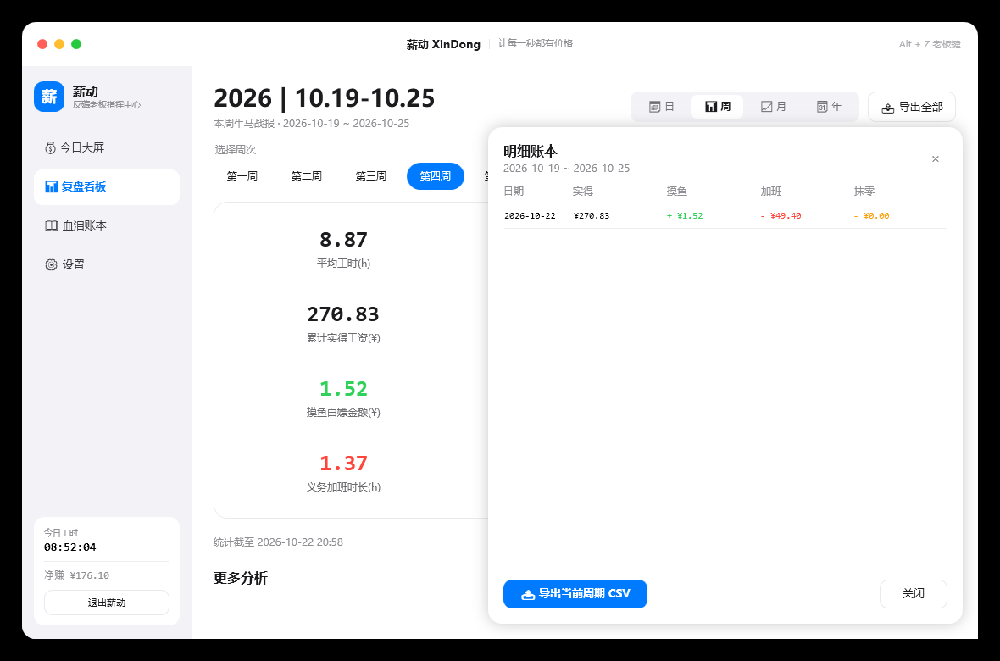

> 看板重构的详细口径与交互见 [docs/board-requirements.md](docs/board-requirements.md)。

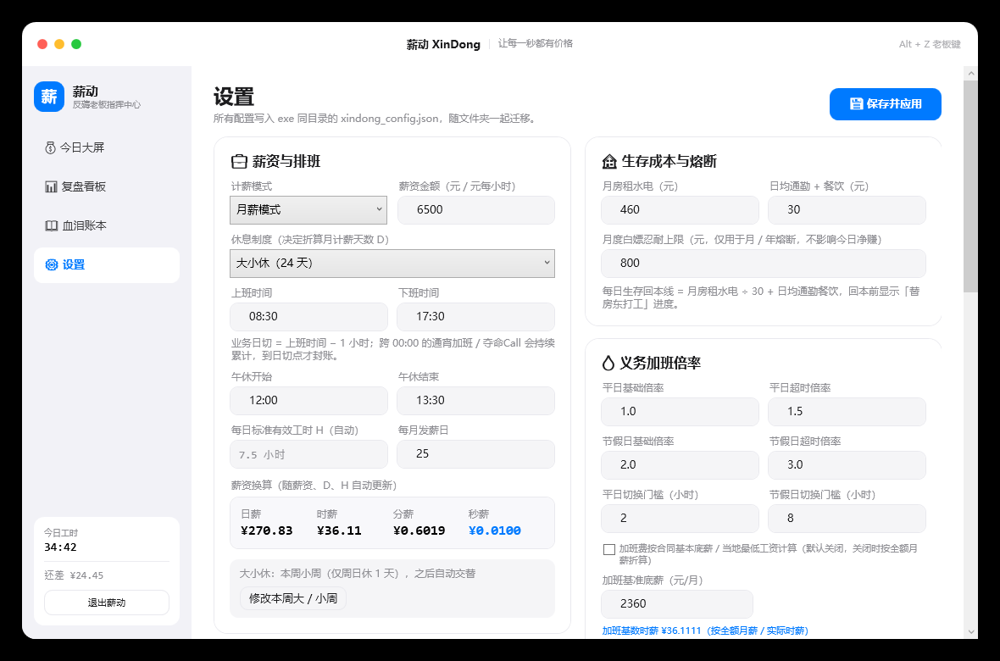

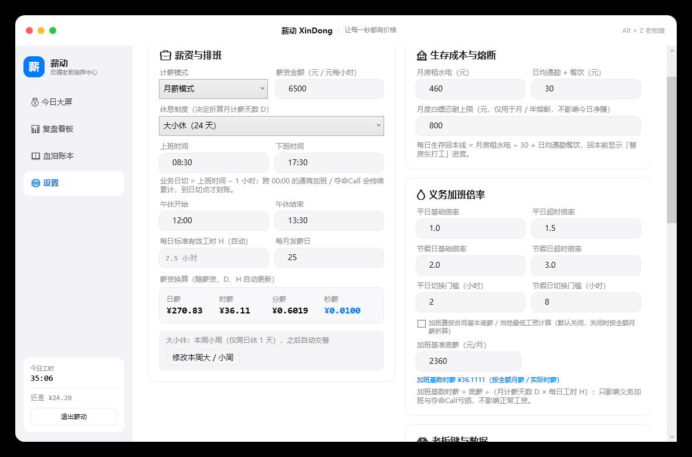

---

## 一、构建

```bat
build_portable.bat
```

内部执行：

```bat
dotnet publish XinDong.csproj -c Release -r win-x64 --self-contained true -p:PublishSingleFile=false
```

输出：`publish\XinDong\`（self-contained，目标机无需安装 .NET）。

也可以直接：

```bat
dotnet build -c Release
```

> 当前目录下已有一份 `publish\XinDong\`，可直接双击 `XinDong.exe` 体验。

## 验证记录

- `dotnet build -c Release`：0 错误 0 警告，`dotnet list package` 确认无任何包引用。
- 2026-10-28 QA 回归：72 项定向探针全部通过（72/72）；修复混合 Call、撤回空档、离线跨天 Call、保存失败、摸鱼恢复/裁剪、自动补齐取整、排班缩短、凌晨时间、实时看板、负倍率、首装薪资等 16 项失败。
- 计薪逻辑探针（无界面）：22 项断言全部通过，覆盖月薪秒薪、时薪阶梯、20~29 分钟强拦截、整点半点放行、含泪下班抹零入账、对冲净值与熔断。
- 时间轴 / 摸鱼记忆探针：13 项断言全部通过，覆盖「上班时间起算」「旧运行时长被覆盖」「时薪 25 分钟拦截」「摸鱼会话跨强杀恢复」。
- 自动 H 实测：08:30–17:30 + 午休 12:00–13:30 → H=7.5 小时；日薪 ¥208.33、时薪 ¥27.78、分薪 ¥0.4630、秒薪 ¥0.0077。
- 加班 / 净赚探针：5 项断言通过，覆盖「改薪资后加班亏损同步重算」「净赚扣除加班与抹零」「旧账本按加班时长反推下班时间」。
- 老板键实测：本机 `Alt + Z` 被占用（Win32 1409）时自动降级到 `Ctrl + Alt + Z`，主窗口隐藏 / 恢复正常；B1/B2 切换即时改变灵动岛暗语文本。激活状态已持久化：配置 `BossKeyActive=true` 重启后主窗口保持隐藏、灵动岛保持 PLC，按老板键退出后写回 `false` 并恢复主窗口。
- 节假日同步实测：2026 官方安排 `休 33 天 / 班 6 天 / 法定 13 天`；接口失败自动回退内置表（2025 / 2026），再失败保留原配置。
- 节假日月历实测：点日期即时切换，`双休 18 上 / 13 休` → 点一天 `17 / 14` → 再点恢复 `18 / 13`；月休 4 天选满 4 天后阻止第 5 天并提示名额已满。
- **误触下班撤回实测**：`OffDuty` → 撤回后状态恢复计时，`RoundingLoss=0`、`RoundingLostSeconds=0`，今日已赚 / 有效工时 / 摸鱼金额保留；下班到撤回之间的空白不会补算。
- **夺命 Call 实测**：纯白嫖 1.52s → 亏损 `¥0.0337`；固定补贴 `¥100` 在结束时一次性入账；按时薪 `¥60/h` 实时入账且亏损为 0；三者均写入 `[夺命Call]` 标签与 CSV。
- **跨天实测**：23:00–08:00 的夺命 Call 跨过 00:00 持续累计，08:00 日切后旧账本记录 `EmergencyCallSeconds=32400`、`EmergencyCallLoss=717.24`、`IsOffDuty=true`，新账本从 0 开始；00:30 仍归属昨天。
- **加班基数实测**：双休 `D=21.75 / H=7.5`，月基数 `2490` → 加班基数时薪 `¥15.2644`；普通加班与夺命 Call 亏损均按该基数计算，历史记录分离重算。
- **身价实测**：无加班时实际时薪 = 标准时薪、贬值 0%；有加班时按 `固定日薪 ÷（H + 加班工时）` 实时下降。
- **自动补齐实测**：31 天窗口内生成 24 条缺失工作日记录，全部 `IsOffDuty=true`、`AutoFilled=true`、`WorkedSeconds=27000`、`NormalEarned=¥270.83`，已有日期未重复。
- **当天自动下班实测**：07:00–08:00 班次、09:00 启动时自动按 08:00 封账，`WorkedSeconds=3600`、`AutoFilled=true`，未误算通宵加班。
- **确认下班时间实测**：手动选 09:47 下班时按该时间结算，`AutoFilled=false`；选择晚于下班时间时只累计到选定时刻，义务加班与亏损同步重算。
- **大小休实测（逻辑探针）**：大周 = 周六日休 2 天（10/24、10/25 均休）；小周 = 仅周日休 1 天（10/31 周六上班、11/01 周日休），按锚点自动交替。
- 日历当天实测：今日格为 2px 蓝色描边 + 右下角「今天」蓝标，鼠标悬浮仅浅蓝细边，不会与今日混淆。
- 灵动岛实测：正常态显示 `今日已赚 / 摸鱼赚 / 义务加班扣 / 总工时`；下班态 `↩️ 撤回 / 🚨 Call` 可见；夺命 Call 血红警报层、实时亏损与 `🛑 放我走` 已验收；B1 PLC、B2 Excel 三项映射与条件总工时正确；固定 520×44 透明窗口 + 内部胶囊缩放后，收起/展开不再改窗口尺寸，右/中/左三种锚点均实测方向正确，B1/B2 摸鱼按钮可见且可点。
- 总工时实测：有效 07:30:00 + 义务加班 01:22:04 = 今日工时 08:52:04（加班按秒，无取整）。
- 看板工时实测：日 / 月维度均显示 有效 07:30:00、加班 01:22:04、摸鱼 00:02:31、总工时 08:52:04，日均按 1 个有工时的天计算。
- 看板 v2 UI：日 / 周 / 月 / 年两级导航、单周/整月日历、周次胶囊、12 月圆圈、年份胶囊、明细抽屉与 12 宫格零值置灰均已完成截图验收。
- 看板 v2 回归参数：`--page=board --view=Daily|Weekly|Monthly|Yearly --date=2026-10-22 --calendar=expanded --detail --analysis`。
- 看板 12 宫格实测：日视图 8.87h / 1 天 / 0 休息 / 270.83 / 1 / 225.50 / 1.52 / 0.04 / 1 / 1.37 / 49.40 / 0；月视图休息天数随排班动态变化（双休 + 2026 法定节假日时 10 月为 13 天）。
- 设置页绑定：逐属性刷新，不再每秒回写 `Config`；UI Automation 实测输入值 2 秒内不被重置，保存后正确写入 JSON。
- 灵动岛：实测收起 `64×20` 贴右边缘（只剩一个状态点，不显示金额）、悬浮展开 `520×44`、移出 0.8 秒收回；B1/B2 收起态摸鱼亮绿灯、不摸鱼亮蓝灯。
- `publish` 后的便携版启动冒烟测试通过，未产生异常日志。

## 二、数据文件

| 文件 | 说明 |
|---|---|
| `xindong_config.json` | 薪资、排班、节假日 / 调休 / 常规休息、生存成本、老板键等配置 |
| `xindong_ledger.json` | 每日账本（正常收益 / 摸鱼 / 加班 / 抹零 / 明细） |
| `xindong_ledger.bak.yyyyMMdd.json` | 每日自动备份，保留最近 7 份 |
| `xindong_error.log` | 仅在未处理异常时生成 |

## 三、核心规则

- **月薪模式**：`日薪 = 月薪 ÷ D`，`秒薪 = 日薪 ÷ (H × 3600)`；「今日已赚」每整秒跳动一次，保留 4 位小数。
- **首次启动薪资引导**：干净安装首次打开会先弹「设置薪资」，由新用户选择月薪 / 时薪并自行填写金额；不预填测试薪资，稍后可在设置页修改。
- **薪资保存**：设置页金额输入框失焦会自动保存；旁边也有「保存薪资」按钮。即使其它排班项校验未过，也不会把 7000 这类金额改动丢掉。
- **H 自动折算**：`H = 下班 − 上班 − 与工作区间重叠的午休`，不再手填；设置页实时显示 **日薪 / 时薪 / 分薪 / 秒薪** 四个结果。
- **时间轴口径**：今日工时 = `上班时间 → 现在`（扣午休，月薪按 H 封顶），不是"软件打开时长"；关掉软件再打开、甚至电脑休眠，都会按真实时间补齐。
- **业务日与日切**：每日刷新点 = `上班时间 − 1 小时`（如 08:30 上班 → 07:30 日切），不是自然日 00:00。00:00 后继续通宵加班 / 夺命 Call 时数据仍归昨天，直到日切点才封账并平滑进入新一天。
- **误触下班撤回**：`OffDuty` 状态常驻 `↩️ 手滑了 / 继续搬砖`；撤回恢复计时，清除下班抹零并保留今日已赚、有效工时、摸鱼金额。
- **月薪零加班费**：月薪模式到达下班时间后基础工资锁死在日薪上限，显示 `🔒 今日工资已封顶`；普通加班与夺命 Call 不再增加基础工资。
- **老板夺命 Call**：`OffDuty` / 节假日可触发，先弹窗选择纯义务白嫖、固定补贴或按实际加班时薪计酬。无偿模式按 2.0×（工作日下班后）/ 3.0×（周末节假日）累计老板少给；有偿模式只计收益。
- **夺命 Call 落账**：结束后时长、亏损 / 收益写入当日账本，并打 `[夺命Call]` 标签；无偿亏损计入 `OvertimeLoss`，有偿收益计入 `NormalEarned`。
- **身价暴跌**：`当前实际时薪 = 固定日薪 ÷（H + 今日累计义务加班工时）`，看板实时显示相对标准时薪的贬值百分比。
- **自动补齐**：启动时检查最近 31 天内缺失的排班工作日，按完整 H + 完整日薪生成已下班记录，并标记 `🤖 自动补齐`；已有记录、休息日和当天不覆盖。
- **当天忘记打开**：如果启动时已过下班时间，且没有已记录的加班 / 夺命 Call，自动按正常下班封账，不把“忘记打开”误算成通宵义务加班。
- **确认下班可选时间**：点击「确认下班」先弹时间选择，默认当前时间；时间用双列滚轮上下滑动 / 滚轮 / 拖动选择，可回填更早时间，但**不能超过当前时间**，超过会自动回弹到当前时间。按选定时间重算工时、义务加班、抹零与亏损，选定时间之后不再计入。只改时间不改业务日期，凌晨时间自动归到次日。
- **总工时口径**：`今日工时 = 有效计薪工时 + 义务加班实际秒数`；义务加班按秒累计，不做半点 / 整点取整（取整只用于时薪模式的到手工资锁定）。
- **摸鱼记忆**：摸鱼会话的开始时间实时写入账本；软件被关闭或被强杀后重新打开，会继续累计这次摸鱼，已白嫖金额不丢。
- **时薪模式**：扣除午休后的有效工时，满整点算 1 小时、满半点算 0.5 小时、不满半点不计；实时显示「锁定到手」与「距下一阶梯倒计时」。
- **防抹零拦截**：时薪模式下零头落在 **20~29 分钟** 点「确认下班」会被强制拦截，提示还差多少秒能凑满半点、能多拿多少钱；执意下班则零头清零并记入抹零损失。
- **休息制度 D**：无休 30 / 月休 2 天 28 / 月休 4 天 26 / 大小休 24 / 双休 21.75。
- **排班规则**：双休自动周六日休；大小休选制度时询问本周大/小周（大周周六日休 2 天，小周仅周日休 1 天），之后自动交替；月休 2/4 在月历手选，选满名额后阻止继续选；无休每天上班。
- **节假日与调休**：设置页全宽月历，年份/月份切换，一键同步 2026 国务院安排（优先网络 API，失败读内置 2025/2026 表）；红色 `休` 为法定停计，蓝色 `班` 为补班，普通周末只做浅灰底不挂角标。点击日期即时切换并保存；重置本年只清特殊日期，不改工资与休息制度。
- **排班优先级**：补班日 > 法定/自定义假日 > 今日休假 > 手选常规休息 > 休息制度规则；看板、日历、今日页、加班判定共用同一口径。
- **生存回本线**：`月房租水电 ÷ 30 + 日均通勤餐饮`；`今日净赚 = 今日已赚 − 生存成本 − 义务加班亏损 − 抹零损失`，负数显示「还差 / 倒贴」。
- **加班金额可重算**：确认下班时可选择实际下班时间；事后改薪资、改倍率，都会按当前配置重算加班时长与亏损，不会出现「时长 1:22、金额却按旧时薪」的错位。
- **摸鱼**：4 种姿势独立累计时长与金额，单次超 15 分钟灵动岛闪烁提醒。
- **义务加班**：平时 1.0×（超 2h 后 1.5×），节假日 2.0×（超 8h 后 3.0×），门槛可在设置里改。
- **加班费基数**：设置页可勾选「加班费按合同基本底薪 / 当地最低工资计算」，填写月基数（默认关闭，关闭时按全额月薪 / 实际时薪）。折算公式为 `基数 ÷（月计薪天数 D × 每日工时 H）`；只影响加班亏损，不影响正常工资。保存时按当前基数与当前倍率重算全部历史加班记录，夺命 Call 亏损与普通加班分开重算。
- **看板 v2**：日 / 周 / 月 / 年两级导航——日视图单周日历（可展开整月）、周视图周次胶囊、月视图 12 月圆圈、年视图年份胶囊；核心区为 **3×4 十二宫格**，零值自动置灰；周 / 月 / 年底部有统计时间与明细抽屉（支持导出当前周期 CSV）。旧的「对冲净值盘 / 摸鱼姿势成分 / 熔断警报」保留在「更多分析」折叠区。
- **单实例唤出**：重复双击 exe 不会开第二份计时器；如果主窗口已收进托盘 / 被老板键隐藏，会通知已运行实例恢复主窗口并置前。
- **开机自启动**：设置页「启动与运行」可勾选，优先写入当前用户 `HKCU\Software\Microsoft\Windows\CurrentVersion\Run`，不需要管理员权限；取消勾选会检查注册表、启动快捷方式和登录计划任务均已删除。已有启动项会直接识别，手动导入 `.reg` 后重新打开软件也会同步开关状态。写入后会读回核对，配置保存失败会单独提示。若系统策略拦截，可生成 `.reg` 手动导入，或按提示以管理员权限重试。
- **老板键**：`Alt + Z` 或灵动岛鼠标中键；若 `Alt + Z` 已被其它软件占用，会自动降级到 `Ctrl + Alt + Z` / `Alt + Shift + Z` / `Ctrl + Shift + Z`，实际组合显示在设置页。模式 A 彻底隐身（托盘透明图标、ToolTip 为 `System Host Service: Normal`），模式 B 伪装 PLC 调试条 / Excel 状态栏；设置里切到 B1 / B2 会立即在灵动岛预览，重启后保持所选伪装外观。老板键模式与激活 / 退出状态都会写入配置，重启后保持上次状态，只有主动切换才改变。
- **透明托盘**：正常态和老板键态都使用完全透明的托盘图标，不在通知区域露出品牌图标；需要恢复主窗口时双击 exe、按老板键，或使用已在运行的实例唤出。
- **伪装态摸鱼**：B1/B2 下灵动岛保留鱼形快捷按钮；点击可开始 / 结束摸鱼，按钮右上角绿点表示摸鱼中，ToolTip 同步提示「运行中」。
- **灵动岛伪装映射**：正常态显示今日已赚、摸鱼赚、义务加班扣、总工时；B1 按顺序映射 `Mem / Cache / Err / Run`，B2 映射 `平均值 / 计数 / 求和 / 耗时`。义务加班 > 0 时才显示最后的时间项；B1 的 Err 不带 `%`，B2 计数用 `1.68K` 这类量级伪装。

## 四、灵动岛

- 外层窗口固定 **520×44**，真正缩放的是内部胶囊，避免窗口级 resize 掉帧；胶囊外透明区域通过 `WM_NCHITTEST` 穿透，不挡下层窗口。
- 默认贴住屏幕右侧边缘（距顶 40px），收起成 **64×20** 小胶囊，只露出一个中性状态点，不显示 `¥` / 金额。
- 鼠标移入展开成 **520×44**，移出 0.8 秒后自动缩回。
- 锚点按屏幕位置自动判断：右侧空间不足 → 右边缘固定、向左展开；左侧空间不足 → 左边缘固定、向右展开；左右都 ≥228px → 居中、两边同时展开。拖动后松手重新计算。
- 展开/收起使用 220ms EaseOutCubic 缓动，胶囊宽度、高度、圆角、内容透明度共用同一进度；文字层固定 520×44，缩放时不会重排闪烁。
- 正常态显示：`状态 + 今日已赚 + 摸鱼赚 + 义务加班扣 + 总工时 + 摸鱼/休假按钮`。
- 下班态常驻 `↩️ 撤回` 与 `🚨 Call` 两个快捷按钮；夺命 Call 进行中切换为血红警报层，显示实时亏损 / 收益、已白干时长和 `🛑 放我走`。
- B1 / B2 伪装态同样可收起；收起态不摸鱼亮蓝灯、摸鱼亮绿灯，和原始收起状态保持一致。
- 伪装态保留一个带浅色底的低调摸鱼按钮（B1/B2 都可见、可点），但不弹工资 / 摸鱼中文提醒。
- 收起位置下移 40px，避开最大化窗口右上角的最小化 / 关闭按钮。

## 五、快捷键与交互

| 操作 | 效果 |
|---|---|
| `Alt + Z` | 老板键：隐身 / 伪装 ↔ 恢复（被占用时自动降级，实际组合见设置页） |
| 灵动岛鼠标中键 | 同上 |
| 灵动岛左键拖动 | 移动悬浮窗 |
| 红绿灯 🔴 | 老板键 |
| 红绿灯 🟡 | 主窗口收进灵动岛 |
| 红绿灯 🟢 | 开始 / 结束带薪摸鱼 |
| 托盘双击 | 恢复主控台（隐身态下同时解除） |

## 六、工程结构

```
XinDong.csproj
app.manifest
App.xaml / App.xaml.cs
Models/AppModels.cs
Services/StorageService.cs
Services/HolidayService.cs
Services/StartupService.cs
Data/china_holidays.json      （嵌入 exe 的 2025 / 2026 兜底表）
Services/HotKeyService.cs
ViewModels/MainViewModel.cs
ViewModels/RelayCommand.cs
Views/MainWindow.xaml(.cs)
Views/DynamicIslandWindow.xaml(.cs)
Views/AlertWindow.xaml(.cs)
Views/EmergencyCallWindow.xaml(.cs)
Views/ClockOutTimeWindow.xaml(.cs)
build_portable.bat
```

## 七、已知边界

- 只支持普通白班（下班时间必须晚于上班时间）；跨 00:00 的通宵加班已支持，日切点为上班前 1 小时。
- 自动补齐默认假设缺失工作日为全勤（完整 H + 日薪）；如当天实际请假，需要后续提供手动修正入口。
- 确认下班只改时间、不改业务日期；凌晨时间自动归到次日。
- 开机自启动写当前用户 Run 项；若被组策略或安全软件拦截，设置项会显示失败原因，不会影响软件正常运行。
- Windows 发布流程会将生成的 `XinDong.exe` 设置为普通程序的中完整性级别，避免继承构建目录的低完整性标签后无法设置自启动。该步骤只处理发布的 exe，不修改目录权限或系统策略。
- 后台排查可使用 `XinDong.exe --get-startup` 读取 `enabled` / `disabled`，或使用 `--set-startup=on` / `--set-startup=off` 更新启动项和配置；这些命令不打开界面，失败时返回非零退出码并输出错误。
- 节假日一键同步需要联网；离线时使用内置 2025/2026 表，2027 及以后需接口成功或手动点选。
- 历史 JSON 中的旧 `Holidays` / `MakeupDays` 会自动迁移到新排班结构，不会丢失。
- 关闭主窗口默认收进托盘，彻底退出请用托盘菜单或设置页的「退出薪动」。
